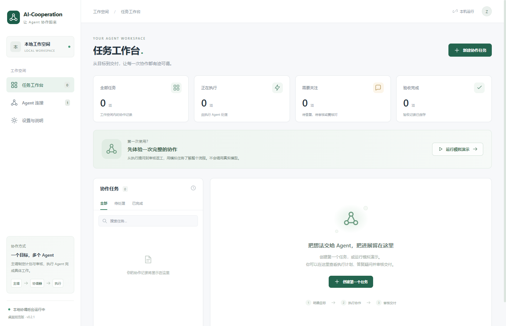

# AI-Cooperation

一个 Windows 本地 AI Agent 协调工作空间。Codex 主调制定计划与审核，AIMana 等执行 Agent 完成具体工作，协调器保存任务、会话绑定和返工记录。

当前版本：**0.2.1 桌面预览版**。Codex 可以同时作为主调和执行 Agent，两者使用独立会话；也支持将执行交给 AIMana 等 A2A Agent。已有 Electron 图形客户端与 SQLite 存储。尚未完成真实 AIMana 端到端联调、已有桌面聊天接管与跨任务并发调度。



## 直接运行 Windows 客户端

本机打包输出：

```text
E:\AI-Cooperation\release\0.2.1\win-unpacked\AI-Cooperation.exe
```

双击即可运行。整个 `win-unpacked` 文件夹是运行包，包含 Electron、配套资源和独立 Node 运行时，不能只复制一个 exe。此目录不会提交到 Git。打包按版本分别输出，不覆盖正在运行的旧程序；更新时先保存或复制旧窗口中未提交的计划，再从托盘完全退出旧版并打开新版。

从源码运行需要 Windows、Node.js 24 和 npm：

```powershell
cd E:\AI-Cooperation
npm ci
npm start
```

`npm start` 自动构建界面并启动桌面程序，不需要另外启动网页或 Windows 服务。首次使用需下载 Electron 运行时；网络有问题时可以配置 Electron 镜像，但必须保留包内校验值验证。

## 第一次使用

1. 打开“任务工作台”，点击“运行模拟演示”。
2. 阅读执行 Agent 的问题，在任务详情中答复。
3. 第一次交付后填写审核意见，点击“要求修改”。
4. 点击“在原会话继续返工”。
5. 检查第二轮结果，填写每项验收证据并点击“验收通过”。

这条流程不调用真实模型，也不修改项目文件。所有模拟任务都明确标有“模拟”，不会自动变成真实模型的完成证据。

## 使用真实 Codex 主调

1. 进入“Agent 连接”，找到默认的“本机 Codex”。
2. 配置本机 `codex.exe` 路径、可选模型名和主调只读工作目录。
3. 使用已有 Codex 登录，点击“测试连接”。该测试读取 app-server 模型列表，不发起模型推理。
4. 新建任务，选择“真实 Agent”，填写具体目标，点击“让 Codex 制定计划”。这一步会实际调用模型，使用对应账号的额度。
5. 计划返回后，可检查或调整执行步骤与验收标准。保存任务时绑定这次主调 thread。

主调会话由协调器通过官方 app-server 创建和持有，不接管当前桌面已有聊天。主调使用只读执行策略，不自动批准修改、认证或权限请求。模型访问是否可用，以真实推理完成为准；模型列表不等于账号对每个模型都具有访问权限。

## 让 Codex 直接执行计划

不必先接入 AIMana。新建真实任务时，“主调 Agent”和“执行 Agent”都可以选“本机 Codex”。

1. 在“新建协作任务”选择“真实 Agent”。
2. 主调和执行都选择 Codex，并为执行 Agent 选择一个具体工作目录。
3. 填写目标，使用“让 Codex 制定计划”，检查步骤和验收项。
4. 创建任务后点击“开始执行”。执行器会创建独立的 Codex thread，在所选目录中实际修改与验证，完成后进入“待审核”。
5. 可人工审核，也可交给原 Codex 主调审核。审核要求修改时，继续原执行 thread；不会把主调会话改成执行会话。

主调使用 `read-only`，执行使用 `workspace-write`，两个角色都不自动批准沙箱外操作。需要额外权限的动作不会被自动放行。执行器通过规范化回报提出疑问，答复与返工继续原上下文。执行超过 15 分钟会请求中断并标记需要核对，不盲目重发。

如需主调与执行使用不同模型，可添加两个不同名字的 Codex 连接，分别配置模型，在新任务里指定角色。费用与额度以所选账号和模型实际情况为准。

执行 thread 和 turn 的绑定会保存到 SQLite。重启时仍未确认结束的 Codex 执行会标为“需核对远端”，保留原 thread，不自动重复执行。

## 使用真实 AIMana 执行

1. 在 AIMana 自己的设置中启用目标 Agent 的原生 A2A 服务，取得真实接口地址与 token。
2. 在协调器“Agent 连接”添加“A2A 0.3 · 执行 Agent”。
3. 填写 JSON-RPC endpoint，例如 `http://127.0.0.1:43120/a2a/v0.3/agents/<agentId>`，不要保留末尾 `/.well-known/agent-card.json`。
4. 输入 token 并保存。token 使用 Windows `safeStorage` 加密存入本机文件，不回显到前端。
5. 点击“测试连接”，确认能读取目标 Agent Card。测试不会发送业务任务，真实执行能力仍需实际派发验证。
6. 新建“真实 Agent”任务，选择该执行器，提供计划与验收项，保存后点击“开始执行”。

执行模型由 AIMana 的对应 Agent 配置决定。协调器不会自动开启 A2A、替你登录或更改 AIMana 模型配置。

执行器的疑问在任务详情中答复；完成后可以人工审核，也可以点击“交给 Codex 审核”。如已由 Codex 制定计划，可在建任务时勾选“由 Codex 自动审核并返工”。自动审核失败会在原执行 context 中开启下一轮，最多执行配置的轮数（默认 5 轮）。执行器的自述不会直接将业务任务标成通过；模型审核仍可能判断错误，正式工作应检查实际产物。

真实执行可能修改你在远端 Agent 授权的工作区。只为明确的目标与范围派发；多个任务对同一个工作区的并发写入隔离尚未实现。

## 本地存储与退出

默认目录：`%LOCALAPPDATA%\AI-Cooperation\`。

```text
cooperation.sqlite       任务、计划、事件、审核和连接配置
cooperation.sqlite-wal   SQLite WAL，运行期间可能存在
cooperation.sqlite-shm   SQLite 共享内存文件，运行期间可能存在
credentials.json         本机加密的 A2A token
```

关闭窗口会进入系统托盘，后台继续轮询。通过托盘或“设置与说明 → 完全退出”关闭后台。远端任务可能继续运行，本地退出不代表远端取消。

重启后保留任务历史；如果退出发生在发送过程中，该任务进入“需核对远端”，系统不会盲目重发。连接失败采用递增间隔重新轮询。已有 token 不会通过普通日志、任务报告或连接列表返回给界面。

## 开发与验证

内核/协议测试覆盖 Codex 主调与执行的独立会话、提问答复、原会话返工、自动审核和重启后的未知执行状态。桌面测试覆盖无需 A2A 连接直接选择 Codex 开工，以及工作目录缺失时的明确提示。A2A 测试使用本机 HTTP fixture，不能替代真实 AIMana 联调。

0.2.1 已完成一次真实双 Codex 闭环：主调生成计划，执行 Agent 在新建临时工作区写入并验证 hello.txt，原主调独立检查后验收通过，双方 thread 不同。另验证了实际驳回后的原执行会话返工。自动化验证包含 15 项内核/协议测试和 4 项桌面测试。

```powershell
npm test                # 内核、SQLite、Codex 协议及 MCP 测试
npm run test:desktop    # 真实 Electron 界面闭环与重启验证
npm run package:win     # 构建可独立运行的 Windows 目录包
npm run demo            # 保留的命令行模拟演示
npm run mcp             # 保留的 CLI/MCP 入口
npm run verify:codex    # 可选真实双 Codex 验证，会使用模型额度，仅写新建临时目录
```

保留的 MCP/CLI 原型采用 JSON 文件存储，与桌面 SQLite 数据暂未统一。它仍可单独运行，但不应把其任务当成已出现在桌面工作台中。详见[命令行原型文档](docs/PROTOTYPE.md)。

桌面由 Electron 窗口和一个独立 Node 后台进程组成，内部通过 IPC 通信，不注册 Windows Service，也不开放协调器 HTTP 端口。React/TypeScript/Vite 负责界面，SQLite/better-sqlite3 保存状态。打包时绑定 Node 运行时与其 native 模块，避免 Electron ABI 与 Node ABI 混用。

## 目录

```text
desktop/       Electron 窗口、托盘、安全凭据与 preload
ui/            React + TypeScript 界面
backend/       独立后台、SQLite、真实 Codex 主调适配器
src/           共用任务状态机与 A2A 适配器
test/          内核与协议测试
desktop-test/  Electron 界面测试
scripts/       Windows 打包
docs/          原型说明
DESIGN.md      方案基线与版本交付状态
```

源码仓库：[zhangmaofa/AI-Cooperation](https://github.com/zhangmaofa/AI-Cooperation)。
