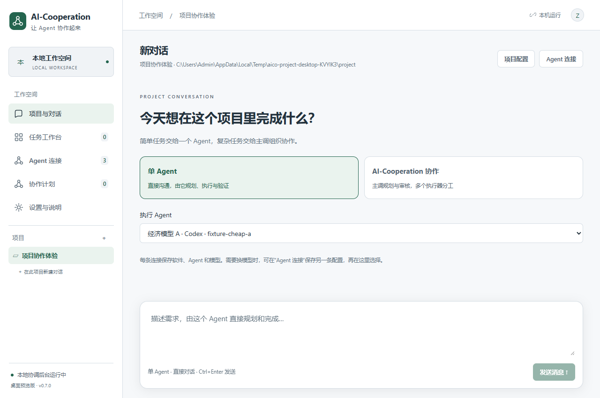

# AI-Cooperation

一个 Windows 本地 AI Agent 协调工作空间。Codex 主调制定计划与审核，AIMana 等执行 Agent 完成具体工作，协调器保存任务、会话绑定和返工记录。

当前版本：**0.7.1 桌面预览版**。提供项目与历史对话，单 Agent 直接执行和 AI-Cooperation 多 Agent 协作两种模式。保留主题设置、任务工作台、依赖调度、原会话返工、主控答疑与总体审核。Codex 可分别担任主控和执行，AIMana Cowork / ACP 可作为执行器；远端 A2A 继续通过任务工作台使用。真实 AIMana 用户账号配对及执行仍需实测；项目聊天使用协调器新建的原生会话，不接管已有桌面聊天。



## 直接运行 Windows 客户端

本机打包输出：

```text
E:\AI-Cooperation\release\0.7.1\win-unpacked\AI-Cooperation.exe
```

0.4.1 将托盘、窗口及 Windows 程序文件图标统一为绿色协作节点标识，提供多尺寸 ICO 以适配系统缩放。图标源文件位于 desktop/assets/app.svg，可运行 node scripts/generate-icons.mjs 重新生成。AIMana 连接插件在 0.5.0 新增打开原 Cowork 会话的能力，需要重载新插件。

双击即可运行。整个 `win-unpacked` 文件夹是运行包，包含 Electron、配套资源和独立 Node 运行时，不能只复制一个 exe。此目录不会提交到 Git。打包按版本分别输出，不覆盖正在运行的旧程序；更新时先保存或复制旧窗口中未提交的计划，再从托盘完全退出旧版并打开新版。

从源码运行需要 Windows、Node.js 24 和 npm：

```powershell
cd E:\AI-Cooperation
npm ci
npm start
```

`npm start` 自动构建界面并启动桌面程序，不需要另外启动网页或 Windows 服务。首次使用需下载 Electron 运行时；网络有问题时可以配置 Electron 镜像，但必须保留包内校验值验证。

## 0.7.1 原生执行进度、回合核对与桌面显示

- 修复长任务只显示“Agent 正在工作”的问题。接入 Codex 的公开阶段消息、回复增量和工具活动信号，显示已用时间、最近收到进度、事件数与工具活动次数。事件批量节流后也会补刷最后一段，避免短回复一直等到最终完成才显示。
- 只展示公开的 Agent 消息；推理流和工具原始输出只作为活动信号，不展示其内容。阶段消息不当成最终答案，最终结果以原生回合状态与最终答复为准。
- 工作中也可点击“核对原回合”。90 秒没有新活动时会限频读取同一回合状态；若完成事件丢失，读取已完成结果并结束本地等待，不创建新会话或重新发送问题。原生明确失败会显示失败原因，网络结果不明仍保持待核对。
- 会话信息可查看原生 thread / turn ID。对话页新增“在 Codex 桌面打开原对话”，协作子任务可打开对应的执行会话，使用官方 `codex://threads/<id>` 链接展示同一份原生记录，不复制聊天或重发问题。新会话会尝试设置与任务相同的可读标题。
- “设置与说明 → Codex 桌面显示”可开启“本轮结束后自动打开 Codex”，默认关闭，单轮回复、需要用户答复或总体完成时打开；启动和重复轮询不重放旧窗口。桌面用于查看原记录，当前不支持桌面手动输入与协调器历史的双向同步，任务运行时应由协调器负责继续派发。
- 直接执行提示补充先简短说明处理方式、长任务公开阶段进度和优先定向检索，避免无必要重复全仓遍历。界面反馈改善不代表模型的实际分析时间被缩短。

协议依据：[OpenAI 官方 App Server 文档](https://learn.chatgpt.com/docs/app-server)、[官方桌面链接说明](https://learn.chatgpt.com/docs/app/commands)。验证覆盖 61 项内核/协议测试、11 项桌面测试（含打包程序启动），新增公开进度与文字增量、陈旧事件过滤、明确失败、丢失完成事件后只读核对、原会话桌面链接和自动打开去重等路径。另用已完成的真实 Codex 会话验证只读 `thread/read` 能取回最终报告，并验证本机注册协议成功打开原会话，未重发原问题、未增加模型推理。

## 0.7.0 项目与对话

1. 点击左侧项目区的“＋”或“添加第一个项目”，填写名称并选择已有工作目录，保存项目。
2. 点击项目或“在此项目新建对话”，在开始页选择模式、软件与模型配置，然后发送需求。
3. **单 Agent**：只选一个执行器，由它直接回答用户、设计方案、修改与验证；后续消息沿用同一个原生会话，没有额外主调审核。
4. **AI-Cooperation 协作**：选择一个主调与最多十个执行器。主调先在项目目录只读分析并出计划；检查步骤、依赖和验收后点击“开始协作”。执行器疑问、进度和交付汇总到本对话，主调自动答疑、审核并在原会话要求返工。需要用户决定的问题，在聊天框选择对应子任务回复，先由原主调整理再交回执行器。
5. 项目、配置与对话保存在 SQLite，左侧可切换历史对话，重启恢复上次选中的项目和聊天。工作中的回合不会因为重启就自动重发；不确定时通过“核对原回合”恢复。

“设置与说明 → 新项目的默认 Agent 配置”设置默认模式与角色；“项目配置”可覆盖该项目的默认值。每条“Agent 连接”对应软件、模型及可选 AIMana Agent 的配置，同一软件可保存多条不同模型连接。已有对话固定原配置；改变项目默认值不会修改老对话。计划确认前若执行器连接被修改，会拦住开工，要求恢复原配置或新建对话，避免暗中换模型。

主调目前只支持 Codex 的规划与只读审核；Codex、ACP 和 AIMana Cowork 可参与本地项目执行。AIMana 必须在原软件中有相同项目目录，单 Agent 模式需安装并重载 **0.7.0** 或更新版连接插件，再测试连接刷新能力；整个过程不要求管理员 Workspace 权限。所有本地角色默认使用项目目录，修复旧版初次规划与总体审核仍落到连接默认目录的问题。同目录写入仍受统一工作区锁约束，选择多个 Agent 不意味着会同时改同一目录。

对话页面可以查看子任务交付并进入原任务详情；协作支持暂停新工作、继续和原会话返工。执行期间的普通咨询由主调只读回答；改变已开工的任务范围需先暂停，再新建对话确认计划。旧任务与协议入口仍保留在“任务工作台 / 协作计划”。

本轮验证：54 项内核/协议测试、10 项桌面测试（含打包启动）。项目对话通过隔离 Codex JSON-RPC fixture 验证双轮直接执行、双执行器交付与总体验收；AIMana 单 Agent 提示与同原生会话续聊在隔离的已安装 AIMana++ 框架中验证。没有把测试 fixture 当作真实账号或模型额度验证。

## 0.6.0 外观与偏好设置

进入左侧“设置与说明” → “外观与通知”：

- 明暗模式：浅色、深色、跟随 Windows；跟随模式响应系统切换，保存后也同步原生窗口主题。
- 主题颜色：森林绿、海洋蓝、紫罗兰、琥珀橙，覆盖导航、按钮、输入焦点和选中状态。任务警告、失败和已验收使用独立语义色。
- 字体大小：100%、115%、130%、150%，默认 115%；列表、报告、表单与弹窗全局同步，配套调整侧栏及窄窗口布局。
- 外观即时预览，点击“保存设置”写入 SQLite；未保存就离开页面会恢复已保存外观。“恢复默认设置”先预览，仍需保存。
- 桌面通知可关闭，恢复时不重放静音期间的旧提醒。实际显示仍取决于 Windows 通知支持及设置。
- 草稿管理可清空未提交任务和计划表单，需在页面内再次确认。保留已创建任务、原会话、连接、历史与偏好设置。

本轮验证：47 项内核/协议测试、9 项桌面测试（含打包启动）；覆盖设置校验与重启持久化、系统主题切换、大字体布局、草稿清理边界及通知静音。

## 0.5.0 协作与体验更新

本轮参考官方竞品说明并检查实际状态机，记录见 [研究与迭代记录](docs/RESEARCH-2026-10-26.md)。

- 主控长审核不再阻塞全局轮询；独立任务可继续接收结果和调度，同一主控的决策仍排队。
- 总体审核返工上游时，受影响的直接及间接下游撤销旧验收，按依赖在原会话重新验证。执行器收到已验收前置的摘要、目录及验证信息；无关分支保留结果。
- 协作计划可编辑子目标、步骤、验收、依赖和执行器，可添加/删除节点，支持复制已保存计划为新草稿。
- 开工条件检查汇总配置、目录和依赖问题，提示重叠目录会串行；可选择连接握手，不触发模型推理。保存失败回滚本次新建记录，残缺旧计划不能直接开工或验收。
- 单任务和协作计划草稿保存在本机界面存储，切换页面或重启可继续。保存失败会提示保留内容；生成过的主控计划绑定随草稿保留。提交成功后清理相应草稿。
- 计划新增“暂停新工作 / 继续协作”。暂停不取消在途回合；自动流程出错后保留原模式和错误，可由用户继续。不会自动增加轮次或 token 预算。
- 排队显示具体阻塞任务，并可跳转处理；相同排队原因不重复刷事件。收件箱区分待处理和历史，问题与答复可追溯，直接进入对应任务。
- AIMana 任务可打开本插件创建的原 Cowork 会话，处理权限后自动同步状态。确认失败可由用户明确请求原会话重试；未知发送必须先核对，不自动重放。
- 关键人工待办及总体完成可触发静默桌面通知，点击定位任务或计划；不重复提示相同状态，常规自动答疑/自动审核保持安静。实际通知显示由 Windows 系统支持和用户设置决定。

0.5.0 验证：45 项内核/协议测试、8 项桌面测试（含打包启动检查）。真实用户账号 AIMana 配对与模型执行仍待联调，隔离框架测试不能替代真实模型验证。

## 第一次使用

1. 打开“任务工作台”，点击“运行模拟演示”。
2. 阅读执行 Agent 的问题，在任务详情中答复。
3. 第一次交付后填写审核意见，点击“要求修改”。
4. 点击“在原会话继续返工”。
5. 检查第二轮结果，填写每项验收证据并点击“验收通过”。

这条流程不调用真实模型，也不修改项目文件。所有模拟任务都明确标有“模拟”，不会自动变成真实模型的完成证据。

## 使用真实 Codex 主调

1. 进入“Agent 连接”，找到默认的“本机 Codex”。
2. 配置本机 `codex.exe` 路径、可选模型名和主调只读工作目录。
3. 使用已有 Codex 登录，点击“测试连接”。该测试读取 app-server 模型列表，不发起模型推理。
4. 新建任务，选择“真实 Agent”，填写具体目标，点击“让 Codex 制定计划”。这一步会实际调用模型，使用对应账号的额度。
5. 计划返回后，可检查或调整执行步骤与验收标准。保存任务时绑定这次主调 thread。

主调会话由协调器通过官方 app-server 创建和持有，不接管当前桌面已有聊天。主调使用只读执行策略，不自动批准修改、认证或权限请求。模型访问是否可用，以真实推理完成为准；模型列表不等于账号对每个模型都具有访问权限。

## 让 Codex 直接执行计划

不必先接入 AIMana。新建真实任务时，“主调 Agent”和“执行 Agent”都可以选“本机 Codex”。

1. 在“新建协作任务”选择“真实 Agent”。
2. 主调和执行都选择 Codex，并为执行 Agent 选择一个具体工作目录。
3. 填写目标，使用“让 Codex 制定计划”，检查步骤和验收项。
4. 创建任务后点击“开始执行”。执行器会创建独立的 Codex thread，在所选目录中实际修改与验证，完成后进入“待审核”。
5. 可人工审核，也可交给原 Codex 主调审核。审核要求修改时，继续原执行 thread；不会把主调会话改成执行会话。

主调使用 `read-only`，执行使用 `workspace-write`，两个角色都不自动批准沙箱外操作。需要额外权限的动作不会被自动放行。执行器通过规范化回报提出疑问，答复与返工继续原上下文。执行超过 15 分钟会请求中断并标记需要核对，不盲目重发。

如需主调与执行使用不同模型，可添加两个不同名字的 Codex 连接，分别配置模型，在新任务里指定角色。费用与额度以所选账号和模型实际情况为准。

执行 thread 和 turn 的绑定会保存到 SQLite。重启时仍未确认结束的 Codex 执行会标为“需核对远端”，保留原 thread，不自动重复执行。

## 使用 AIMana 普通 Cowork 执行

0.4.0 改为通过 AIMana++ 调用已有的普通 Cowork 会话接口，**不需要 Workspace 灰度权限，也不需要启用 AIMana 原生 A2A 服务**。手工 A2A 连接仍供具有相应原生权限的软件使用。

1. 保存旧版协调器中未提交的内容，从托盘完全退出旧版，打开本机 0.5.0 客户端。
2. 在“Agent 连接 → 连接本机 AIMana”点击“安装 / 更新 AIMana 连接插件”。已有 AIMana++ 时只复制本连接器的 index.js、gateway.cjs 和 manifest.json。
3. 在 AIMana++ 重载插件，确认显示“连接器 v0.5.0 · 普通 Cowork”。保持 AIMana 的本地主窗口打开。
4. 在新版协调器生成两分钟配对码，在 AIMana++ 的 AI-Cooperation 区块粘贴后点击“配对普通 Cowork”。无需读取账号 token 或填写模型 API key。
5. 回协调器找到“本机 AIMana Cowork”，点击“配置连接”，选择真实可见的 Agent、其引擎当前可用模型、AIMana 已有的工作目录，保存。模型缺省选中该 Agent 默认模型（仍在可用列表时）。可以“保存为另一个执行器”，给多个 Agent 或同 Agent 的不同模型建立配置。
6. 创建真实任务，选择该执行器和已有目录；首次建议使用独立测试项目。原生权限为询问模式，AIMana 的工具权限确认、原生交互请求仍需在原 Cowork 会话处理。

每个任务创建本插件自己的普通 Cowork 会话，Agent 提示词、Skills 和知识配置由 AIMana 原生执行流程加载。不会接管用户已有聊天或修改 Agent 的全局默认值。对同一任务的补充与审核返工继续原 conversation，Agent、模型、目录随任务固定保存。模型按原生可用列表发现，不能承诺账号余额或实际可调用性；AIMana 可能在原生派发过程中自动回退模型，插件发现会话报告模型变化后会阻止结果直接进入待审核状态，需要人工核对，不能保证模型回退发生前已停止推理。

连接插件在随机 loopback 端口提供带鉴权的本地会话桥；首次配对时生成本产品自己的桥凭据，两端分别用 Windows safeStorage 加密保存，不读取或导出 AIMana 的登录 token。端口及发送日志保存于插件私有 cowork-state.json。协作结果可携带 native conversation / turn ID 和会话报告模型。配对码短时、单次有效。

模型以 needs_input 报告的任务疑问走原主控答疑流程；原生权限/交互请求保留给用户处理。只有收到匹配回合的原生 turn_end 且没有后台工作，再读到本轮对应的助手报告，才将本轮标为待审核；窗口空闲和发送成功不能代替完成证据。插件重载或通信中断会保留原回合，未确认发送不自动重试。重启协调器时可用原消息 ID 查询已记录的发送；缺少回合完成记录时仍显示需核对，不能自动重新创建会话。

**真实用户账号的 Cowork 配对与模型执行尚待联调确认。** 本机测试使用实际 AIMana++ runtime、Electron sandbox preload、真实 HTTP/IPC 与模拟原生 Cowork 接口，覆盖选择 Agent/模型、提问答复、原会话返工、权限暂停、模型变化、重复发送防护、取消和热重载。它不消耗真实模型额度，不能替代用户软件联调。当前支持本机已检查的 AIMana 1.12.17 结构，软件升级后需要兼容性验证；远端 A2A Agent 不在此 Cowork 模型适配范围内。

执行器的疑问在任务详情中答复；完成后可以人工审核，也可以点击“交给 Codex 审核”。如已由 Codex 制定计划，可在建任务时勾选“由 Codex 自动审核并返工”。自动审核失败会在原执行 context 中开启下一轮，最多执行配置的轮数（默认 5 轮）。执行器的自述不会直接将业务任务标成通过；模型审核仍可能判断错误，正式工作应检查实际产物。

真实执行会使用目标软件自身的权限。为 A2A 任务填写可访问的本地工作目录时，协调器可执行本地产物验证与重叠目录写入锁；它不会据此改变远端 Agent 工作目录。未声明本地目录的 A2A 任务按同一连接保守串行。不同连接若指向同一个未声明的远端目录，协调器无法自动识别冲突。

## 一个目标，多个执行 Agent

进入“协作计划”，填写总体目标、主控和默认目录，点击“让主控制定协作计划”。检查子目标、执行器、依赖和每个任务的工作目录，保存后点击开工。计划生成、执行、答疑和审核会实际使用所选模型额度。

调度器只派发前置子任务已验收的工作。全局并发默认 2、每连接默认 1，可在设置中调整至 1–10。同一工作区及父子目录共享写入锁，待答疑、待审核、返工或交付状态不明时保留工作区锁。独立目录可并行；主控决策排队执行。

每个子任务独立验收之后，仍须由原主控检查总体目标和集成结果。总体审核失败会指定原子任务，在原执行会话返工；达到子任务轮次或五次总体审核上限时保留未完成状态。人工模式可在工作台逐项处理，再触发总体审核。

## 任务契约、验证与用量

“协作与验收设置”可配置主控自动答疑、约定相对修改路径、独立验证程序与参数、可观测 token 上限、无进展暂停和独立 Git 工作区。

- 疑问、交付和发送记录持久保存在 SQLite。普通疑问可交给原主控回答；需要用户偏好、认证、权限或扩大范围时转交给用户。未确认的发送不自动重发。
- 每项任务自动答疑默认最多 8 次，超过后需要人工处理，避免执行器反复提问形成无限调用。
- 独立验证程序直接启动，不隐式通过 shell。Windows 的 npm 等 `.cmd` 包装不适合直接填写；可用 `node.exe` 运行项目验证脚本。退出码非零、超时或路径范围违规时禁止验收，即使模型提出通过也无效。
- 本地文件按内容哈希生成快照。验证后产物发生变化会阻止验收，可重新验证。快照不跟随符号链接，排除 `.git`、`node_modules`、`dist`、`release` 等目录，扫描最多 3000 项、64 MiB；范围受限任务快照不完整时不能直接验收。约定路径用于指令和验收检查，实际访问权限由执行软件沙箱管理。
- 连续返工没有产物变化或审核重复提出同一意见时暂停，可人工核对后继续；这不自动判定任务通过。
- token 统计只使用协议明确报告的本轮用量，不能视为整个账号的剩余额度。未报告用量的执行器无法保证 token 预算。达到已观测上限时停止后续自动工作，不回滚已产生的调用费用。
- 独立 Git 工作区仅适用于本地 Codex/ACP，从干净的已提交版本创建 detached worktree。产物保存在数据目录的 `workspaces/` 下供审核，不自动合并或删除；P4、非 Git 和未提交修改的目录使用原工作区串行方式。新 worktree 不自动安装依赖。

## 通用 ACP 软件接入

在“Agent 连接”添加“ACP v1”，填写目标软件官方的程序路径、参数数组及默认工作目录，沿用它自己的登录。连接测试只做协议初始化。驱动复用 ACP 会话和消息事件；恢复旧会话需要目标软件声明 `loadSession` 能力，不支持时不会另开会话冒充续接。

当前客户端不提供委托文件系统、终端和自动权限批准；ACP 不提供统一工作区沙箱，实际执行权限取决于目标软件配置。需要客户端提供这些能力的软件可能无法完整工作。已通过 ACP 协议 fixture 验证，未逐一验证所有厂商软件。

## 从原有主控对话调用桌面任务

在“设置与说明”显示本机 MCP 启动配置，添加到主控软件的 MCP 配置中。入口为 `node mcp.mjs --desktop`，通过本机随机端口、带随机访问密钥的 loopback 通道调用**正在运行的同一个桌面后台**，不由另一个进程写 SQLite。配置中无需填写原生 Agent 的连接 token。

工具支持创建任务、查看状态、派发、答疑、审核、核对远端和请求取消，并绑定原主控对话 ID。外部主控自己负责检查产物并决定通过或返工。工具不会自动唤醒关闭或空闲的桌面聊天；主控需在活动回合中持续查询状态。已有桌面聊天接管尚未实现。

## 本地存储与退出

默认目录：`%LOCALAPPDATA%\AI-Cooperation\`。

```text
cooperation.sqlite       任务、计划、事件、审核和连接配置
cooperation.sqlite-wal   SQLite WAL，运行期间可能存在
cooperation.sqlite-shm   SQLite 共享内存文件，运行期间可能存在
credentials.json         本机加密的 A2A token
bridge.json              当前后台的本机 MCP 地址与随机访问密钥，不是模型密钥
workspaces/              可选的独立 Git worktree 与交付产物
```

关闭窗口会进入系统托盘，后台继续轮询。通过托盘或“设置与说明 → 完全退出”关闭后台。远端任务可能继续运行，本地退出不代表远端取消。

重启后保留任务历史、计划绑定和消息记录；未确认执行进入“需核对远端”。Codex 若已记录 thread/turn，可只读查询原轮次结果；缺少确切标识或原轮次仍在运行时继续等待核对，不自动重发。取消先显示请求停止，收到远端终态才能确认。连接失败采用递增间隔轮询。已有 token 不会通过普通日志、任务报告或连接列表返回给界面。

## 开发与验证

0.4.0 包含 35 项内核/协议测试和 7 项桌面测试。新增普通 Cowork 会话桥与执行器配置 UI 测试，另保留本机 AIMana 默认启用与持久化服务配置不一致的原生代码回归。测试覆盖不代表真实 AIMana 账号已验证。

0.3.0 已完成真实多执行器验证：Codex 主控生成两个子任务，两个不同执行会话在独立临时目录并行写入文件，独立 Node 验证程序检查精确字节内容，子任务审核和总体审核均通过。另以 fixture 验证总体审核期间的工作区锁、产物变化拦截、集成验证失败回原节点返工、自动答疑升级、Git worktree 隔离、ACP、MCP 共享数据库与单次配对机制。内核/协议测试共 32 项，桌面测试共 5 项；这些 fixture 不替代真实 AIMana/其他厂商联调。

内核/协议测试覆盖 Codex 主调与执行的独立会话、提问答复、原会话返工、自动审核和重启后的未知执行状态。桌面测试覆盖无需 A2A 连接直接选择 Codex 开工，以及工作目录缺失时的明确提示。A2A 测试使用本机 HTTP fixture，不能替代真实 AIMana 联调。

0.2.1 已完成一次真实双 Codex 闭环：主调生成计划，执行 Agent 在新建临时工作区写入并验证 hello.txt，原主调独立检查后验收通过，双方 thread 不同。另验证了实际驳回后的原执行会话返工。自动化验证包含 15 项内核/协议测试和 4 项桌面测试。

```powershell
npm test                # 内核、SQLite、Codex 协议及 MCP 测试
npm run test:desktop    # 真实 Electron 界面闭环与重启验证
npm run package:win     # 构建可独立运行的 Windows 目录包
npm run demo            # 保留的命令行模拟演示
npm run mcp             # 保留的 CLI/MCP 入口
npm run verify:codex    # 可选真实双 Codex 验证，会使用模型额度，仅写新建临时目录
npm run verify:workflow # 可选真实多执行器 + 独立验证 + 总体审核，会使用模型额度
```

`node mcp.mjs --desktop` 使用统一桌面后台。未带此参数的 `npm run mcp` 仍是旧 JSON 原型，保留兼容性；旧数据不会自动迁入桌面。详见[命令行原型文档](docs/PROTOTYPE.md)。

桌面由 Electron 窗口和独立 Node 后台组成，内部用 IPC，不注册 Windows Service。0.3 为跨应用 MCP 与显式配对新增随机端口的 `127.0.0.1` HTTP 通道：工具请求需随机访问密钥，配对需两分钟单次码，拒绝浏览器 Origin 请求。React/TypeScript/Vite 负责界面，SQLite/better-sqlite3 保存状态；绑定独立 Node 运行时避免 native ABI 混用。

## 参考项目

0.3 的实现参考 [Orchestrator.inc](https://github.com/OrchestratorInc/agent-orchestrator) 的驱动分层与工作区管理、[multiagents](https://github.com/zetbrush/multiagents) 的消息确认与会话续接、[Augani Agent Orchestrator](https://github.com/Augani/agent-orchestrator) 的任务契约，以及 [Agent Duet](https://github.com/chriswu727/agent-duet) 的独立验证和无进展停止机制。核心逻辑在本仓库独立实现，没有整体引入其运行时。研究源码缓存位于忽略目录 `outputs/research/`，不随产品打包。

## 目录

```text
desktop/       Electron 窗口、托盘、安全凭据与 preload
ui/            React + TypeScript 界面
backend/       独立后台、SQLite、真实 Codex 主调适配器
src/           共用任务状态机与 A2A 适配器
test/          内核与协议测试
desktop-test/  Electron 界面测试
scripts/       Windows 打包
docs/          原型说明
DESIGN.md      方案基线与版本交付状态
```

源码仓库：[zhangmaofa/AI-Cooperation](https://github.com/zhangmaofa/AI-Cooperation)。
