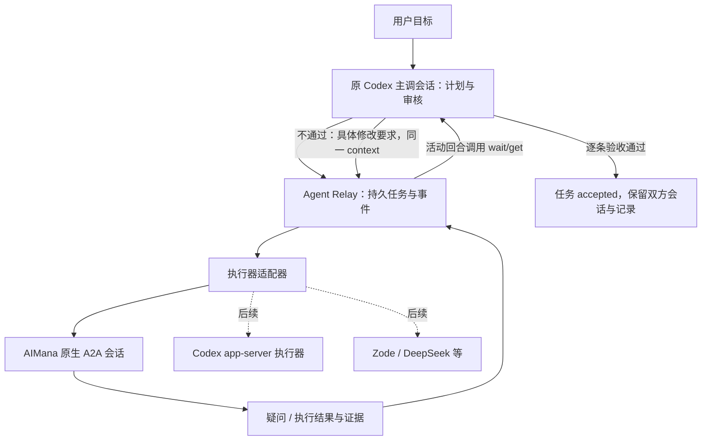

# AI-Cooperation — AI Agent 协调器

独立源码仓库：<https://github.com/zhangmaofa/AI-Cooperation>。本机源码目录为 `E:\AI-Cooperation`。

当前包含 Agent Relay 任务中转内核原型、A2A 客户端、MCP 接口和方案文档；Electron 桌面界面、多 Agent 调度与 SQLite 存储按方案分阶段实现。

目标体验：用户在 Codex 主调会话提出目标，Codex 确定计划与验收标准，将执行交给 AIMana 或其他执行器；执行器的疑问与结果回到原主调，主调检查真实产物后，选择验收或在原执行会话继续返工。

2026-10-25 方案收敛见 [AI 协调器方案基线](DESIGN.md)：独立协调核心、可插拔软件适配器、一个主调与多个执行实例，以及首版真实闭环的技术选型和验收步骤。该文档描述后续实现目标，不改变下表的当前实现状态。

## 当前交付边界

这是可运行的任务中转层原型，尚未完成两个真实桌面软件间的自动闭环。

| 能力 | 状态 |
| --- | --- |
| 固定主调会话、目标、计划、逐条验收标准 | 已实现 |
| 任务、消息 ID、执行上下文、审核历史持久化 | 已实现 |
| 疑问回传、同一个远程任务继续答复 | 已实现，协议模拟验证 |
| 结果先待审核，只有主调审核可以验收 | 已实现 |
| 审核失败后保持 context，在同一对话开启下一次执行 | 已实现，协议模拟验证 |
| A2A 0.3 JSON-RPC 客户端 | 已实现，真实 AIMana 联调待完成 |
| MCP stdio 接入 Codex | 已实现，SDK 客户端握手验证；尚未修改用户 Codex 配置 |
| Codex 桌面主调在活动回合等待结果并审核 | 有工具入口，实际会话联调待完成 |
| 主调空闲、关闭或应用重启后自动唤醒原桌面聊天 | 未实现，需单独验证宿主支持的入口 |
| Codex CLI / app-server 作为执行器或自主主调 | 预留适配位置，尚未实现 |
| Zode / DeepSeek / 其他执行器 | 预留适配位置，尚未实现；需先明确具体产品/API |
| 跨任务并发、工作区文件锁、成本路由和费用统计 | 未实现 |

依赖：Node.js 22+。本机已检测为 24.12.0。依赖仅包含 MCP SDK 与 schema 库，不要求为运行模拟配置模型密钥。

## 架构



关键区别：执行器说“完成”只代表当前执行回合结束，任务进入 `pending_review`。主调必须根据原目标和验收项自行检查文件、diff、测试或其他产物。程序只检查证据引用是否完整，不能判断引用真伪；真实质量判断由主调和实际验证工具负责。

“结束”表示业务任务通过验收，不删除、清空或自动归档聊天。

## 为什么接 AIMana 原生 A2A

本机 `C:\Program Files\mt-aimana\resources\app.orig.asar` 的 1.12.17 包内已经包含 A2A 0.3 服务、agent 配置、context 到 cowork_session 的映射，以及以下入口：

- `/a2a/v0.3/agents/<agentId>/.well-known/agent-card.json`
- `/a2a/v0.3/agents/<agentId>` JSON-RPC 入口
- `message/send`、`tasks/get`
- UI 内部 `a2a:config:get` / `a2a:server:status` 等管理通道

包内默认端口常量为 43120，内部端口常量为 43119。首次检查时，这两个 localhost 端口连接均被拒绝。这只证明默认地址当时没有监听，不能排除用户自定义端口。

AIMana++ 可在后续提供状态面板和入口；中转协议优先复用应用已有能力。此原型没有再修改 AIMana asar、启用其服务、导出其 token 或读取其聊天内容。

## 本地运行

```powershell
cd E:\AI-Cooperation
npm ci
npm test
npm run demo
```

`demo` 是确定性模拟，没有调用真实模型：派发 → 执行器提问 → 主调答复 → 首次交付 → 审核驳回 → 原 context 返工 → 审核通过。模拟数据保留在系统临时目录，控制台输出具体位置。

正式运行的数据默认存放 `%LOCALAPPDATA%\AgentRelay`，可用 `AGENT_RELAY_HOME` 指向独立目录。每个任务一个 JSON 文件，包含完整事件与审核记录。创建临时文件后原子替换；写操作用每任务目录锁避免重复派发。进程异常遗留锁时，确认旧进程已退出并检查任务状态，再人工恢复；程序不会自动删除陈旧锁或自动重发。

## Codex MCP 配置示例

以下是配置样例，并未自动写入用户的 Codex 配置。配置实际应用于哪个 Codex 主机/项目，需要按该宿主的设置方式连接。

```toml
[mcp_servers.agent_relay]
command = "node"
args = ["E:/AI-Cooperation/mcp.mjs"]
env_vars = ["AIMANA_A2A_TOKEN"]
```

在 AIMana 中为目标执行 Agent 启用原生 A2A，取得它实际显示的 endpoint 和凭据。凭据通过启动 MCP 进程继承的环境变量 `AIMANA_A2A_TOKEN` 提供，不应贴进聊天或任务描述。配置环境变量名可用 `executor.tokenEnv` 改变。token 只进入 Authorization header，不写入任务 JSON；此程序不会把它自动传给其他软件。

MCP 客户端需能够访问该 endpoint。重定向不跟随，避免凭据被转发至新地址。HTTP 仅允许 loopback，其他地址要求 HTTPS。

## 主调工作循环

1. 用户授权具体工作；主调明确工作区、修改边界、计划和逐条验收标准，选择执行器与模型。模型由 AIMana 对应 Agent 的配置选择，当前中转层不更改其默认模型。
2. `relay_create`：提供真实主调 `ownerThreadId`、goal、plan、acceptance、executor endpoint。这里的 owner ID 用于路由和防止误混会话，不是独立的身份认证。
3. `relay_dispatch`：派发一次。保存消息 ID 后发送，不自动重试结果不确定的请求。
4. `relay_wait` / `relay_poll`：在主调当前活动回合等结果。wait 返回事件 cursor，后续传入 `afterSeq` 避免重复处理。
5. `needs_input`：主调基于已授权目标回答；涉及未确定的范围、产品决策或授权则由用户决定。`relay_answer` 使用相同 contextId 和 taskId。
6. `pending_review`：主调独立查看产物并验证。`relay_review` 选择 `revise`，给出具体失败项；再 `relay_dispatch`，保持同一个 contextId。A2A 已完成的 task 不可重新启动，返工必须创建同 context 下的新 task。
7. 全部验收项通过：`relay_review` 选择 `accept`，提供每个 C1/C2/... 的 `passed: true` 与 `reference`。只在此处记录 `accepted` 并向用户汇报。

只把中转 MCP 接给有审核职责的主调；不应把审核工具授权给执行 Agent。执行器回报作为证据处理，不能用其文字改变主调计划、授权或验收标准。

当前默认最多 5 次执行轮次，可在创建时设置 `maxRounds`（1..100）。超限时保留 `budget_exhausted`，由主调向用户解释原因，绝不标为成功。这里限制的是轮次，不是实际 token/金额。暂未实现无限后台执行、收费预算、暂停/取消和预算追加；正式无人值守前需补齐。

## 故障与恢复

- 请求断开或响应不可验证：记录 `delivery_unknown` 与原 messageId，不直接重发，避免重复改文件。需对照 AIMana 会话或远端任务确认后再人工恢复。
- 远端 `failed` / `canceled` / `rejected`：不进入审核成功路径。
- 远端 `auth-required`：进入 `needs_user`，不能用普通任务答复绕过权限或认证流程。
- contextId 变化或 poll 返回另一 task：拒绝会话漂移。
- 重启中转进程：任务、目标、plan、contextId 和审核历史仍在。需要主调重新连接读取；当前不会自行唤醒桌面聊天。
- 当前采用远程任务轮询，没有开启 push webhook，也没有运行常驻联网服务。

## 扩展路线

下一步是完成一条真实任务：当前 Codex 主调 → AIMana 指定 Agent → 提问/结果 → Codex 实际审核 → 同一 AIMana 会话返工。验收证据应包含双方会话 ID、context、远程任务 ID、真实文件产物与至少一次驳回重做。

之后增加 `CodexAppServerAdapter`：使用官方 `thread/start` / `thread/resume` / `turn/start` / `turn/completed`，固定 threadId，模型列表动态发现。启动一个 app-server 不等于已经控制当前桌面会话；已有桌面主调的唤醒和并发回合需要单独验证。

DeepSeek 等模型 API 需要独立执行 harness 才能操作工具、文件和维护会话；模型 API 本身不等同于完整执行 Agent。Zode 需先确认具体应用和可调用入口。适配器层最终统一 send / poll / answer / cancel 与能力描述，不强行把不同软件的权限和会话语义当成相同。

多执行器并发时先加入工作区/文件写入互斥和隔离工作目录。当前原型只串行处理每个任务，不保证多个不同任务同时修改同一工程时安全。

## 参考

- [Codex 官方 app-server](https://learn.chatgpt.com/docs/app-server)：会话、回合、完成事件及协议边界。
- [A2A 0.3 协议](https://a2a-protocol.org/v0.3.0/specification/)：message/send、tasks/get、context 与 task 生命周期。
- [AIMana++ tweak 指南](https://github.com/zhangmaofa/AIMana-plusplus/blob/main/docs/WRITING-TWEAKS.md)：可选的后续面板接入。
